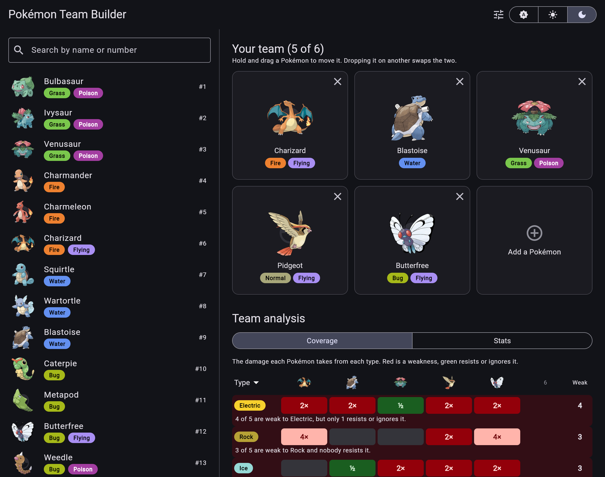

# Pokémon Team Builder

A Flutter web app for building a team of up to six Pokémon and seeing where it is weak. Search the Pokédex and fill six slots. A coverage matrix shows which of the 18 attacking types the team is exposed to, in plain language, and a second tab gives the team's average stats.

Data comes from [PokeAPI](https://pokeapi.co) (free, keyless). A built-in control panel injects latency, failures and bad payloads, so the error handling can be seen working.



## Run it

Requires Flutter 3.50 (stable) and Dart 3.14. Material comes from the separate `material_ui` package that Flutter 3.50 introduced.

```sh
flutter pub get
flutter run -d chrome    # run the app
flutter test             # whole suite, no network needed
flutter analyze          # reports no issues
```

For a release build, which is what the persistence check in the test plan needs:

```sh
flutter build web
python -m http.server 8080 -d build/web
```

## Why PokeAPI, and the angle

PokeAPI is stable, CORS-enabled and cacheable. Its list endpoint returns only names and URLs, so showing anything rich means one request per Pokémon, which is where limiting, caching and retries matter. It rarely fails, so the control panel simulates failures.

The product is analysis rather than a Pokédex: "what is this team weak to, and does anyone cover it?" Only defence is covered, because offence needs move data (D2).

## Architecture and trade-offs

Four layers, with dependencies pointing inwards. `domain` is plain Dart, with no Flutter, Riverpod or `data` imports. Features live in folders under `lib/features/`, and all wiring is in `lib/app/providers.dart`.

```text
data  →  domain  →  state (Riverpod)  →  UI
```

The API client is hand-written and built from decorators (each layer implements `ApiClient` and wraps another):

```text
PackageHttpTransport → FaultInjectingTransport → HttpApiClient (5 s timeout)
  → RetryingApiClient (3 attempts, backoff and jitter) → ConcurrencyLimitedApiClient (6)
  → CachingApiClient (10 min TTL, stale-while-revalidate, de-duplicated)
```

Decisions and what they cost. The reasoning and the alternatives are in [docs/decisions.md](docs/decisions.md).

- **No client library.** Each layer is small enough to read and test alone, at the cost of writing what a library provides. (D4, D12)
- **Failures are returned, not thrown.** Calls return `Result<T>` with a sealed `ApiFailure`, so the compiler makes each screen handle each case. The cost is more code at each call site. Failures are never cached, so "Try again" asks again. (D11, D19)
- **Faults are injected at the transport,** so a simulated 429 or truncated body goes through the same decoding, retry and cache code as a real one. (D12)
- **Riverpod, without code generation.** Analysis is derived state that updates as each member loads. Provider overrides make the tests simple. (D5)
- **Persistence is `shared_preferences`** behind a `KeyValueStore` interface with an in-memory fake. Only the team and theme persist. (D7, D17)
- **Six fixed slots, and a move swaps two.** Slots keep a stable identity for animations and drag targets. The cost is that other cards do not shuffle along. (D20, D21)
- **Coverage and stats share a tabbed panel,** because the matrix is already 18 rows tall. (D31)
- **Time and randomness are injected,** so retry delays and timeouts are tested with `fake_async`. (D13)

## Testing

Tests use fakes, never the network. Coverage:

- **Domain and data:** type-chart maths, team rules, search ranking, parsers against trimmed real responses, and each client layer alone (retry timing with `fake_async`, limiter, cache, de-duplication).
- **Widgets:** each feature's loading, empty, error and incomplete states, drag and drop, screen-reader actions, the control panel, and both animations pumped through their durations. Reduced motion is tested.
- **Flow:** the whole app over the real networking stack and a fake network, with failures at 100% and then recovery.
- **Layout and accessibility:** overflow at 320 px wide and double text size, contrast for every type colour and matrix cell in both themes, and semantics.
- **Live contract (opt-in):** `flutter test --run-skipped --tags live` fetches the index, two Pokémon and all 18 types from the real API, parses them with the app's code, and compares each saved fixture's shape with the live response. A failure may mean the API changed or was briefly down, and the message names the request. (D32)

Many tests were checked to fail with the behaviour removed. The decision log notes where.

## Manual test plan

Run with `flutter run -d chrome` unless stated.

| Area | Steps | Expect |
| --- | --- | --- |
| First run | Open the app | Six empty slots, an invitation in the matrix, a searchable list with pictures |
| Add and remove | Click a result. Click an empty slot, then a result. Click ✕. | The first empty slot fills. The chosen slot fills. Only that slot empties. |
| Persistence | **Release build.** Add three Pokémon, choose dark, reload. Then clear site data and reload. | Team and theme survive the reload. After clearing: an empty team and the system theme. |
| Coverage | Add Charizard | Rock shows 4×, with a sentence naming the gap |
| Team stats | Add two or three Pokémon, open the Stats tab, resize across 900 px | A radar chart of the averages, and who is highest and lowest in each stat. The tab stays on Stats. |
| Details flip | Click a card. Close it with ✕, Esc and a click outside. Move the Pokémon with the buttons, then close. | The card turns into the dialog. The cards behind update as it moves, and it flips back into its new slot. |
| Throw-in | Add a Pokémon. Reload with a saved team. Drag one into an empty slot. | A ball is thrown and the slot reveals. Saved slots throw one after another. Dragging throws nothing. |
| Reduced motion | DevTools → Rendering → emulate `prefers-reduced-motion: reduce`, then add a Pokémon | No ball, just the loading spinner and then the Pokémon. The dialog fades instead of flipping. |
| Reordering | Hold a Pokémon about 0.3 s, drag onto another slot, then onto an empty one | Swap, then move. The team is saved. |
| Without a mouse | Tab to a card, press Enter, then "Move earlier" or "Move later" | The Pokémon moves and the slot number in the dialog follows |
| Real network | DevTools: Network → Slow 3G, then Offline | Visible rows load progressively, images have placeholders, and loaded data still works offline |
| Layout | Widths of 320, 600 and 1000 px, and browser zoom to 200% | Two or three slots across, search in a sheet below 900 px, nothing overflows |
| Themes | Light, dark and system, then reload | No flash of the wrong theme |
| Screen reader | NVDA or VoiceOver over a slot, the matrix and the dialog | "Slot 2, Pikachu, Electric" with move actions, and one sentence per matrix row and per stat |

**Failure handling.** The tune icon in the app bar opens the control panel: delay (0 to 5 s), failure rate and kinds, the wait a simulated 429 asks for, an offline switch, a live retry log, and "Clear cache and reload". The levers are not saved, so a reload resets them. (D27)

| To see | Do this |
| --- | --- |
| Loading states | Delay 3 s, clear cache and reload |
| Retry and backoff | Failure rate 100% with "Server error", clear cache and reload. The log shows three attempts per request and the waits. |
| Failure UI | As above, once the retries run out. Slots, search and the matrix each say what failed and offer "Try again". |
| Recovery | "Back to normal", then "Try again" |
| Bad payloads | "Cut-off response" or "Unexpected response" at 100%. Each shows as a malformed-response failure, not a crash. |
| Incomplete analysis | Make one slot fail. The matrix says it may be incomplete. |

Checked by hand in Chrome: persistence in a release build, dragging, and both animations (not the reduced-motion fade). Not checked on a touch screen or with a screen reader.

## Known limitations

- **Defence only.** Offence needs move data.
- **No compare view.** The dialog's radar chart and the team stats cover most of it.
- **The cache is in memory,** so a reload refetches (the browser's HTTP cache helps). The control-panel levers, the matrix order and the chosen tab are also not saved.
- **With every request failing,** a slot shows the resting ball for about 16 seconds before its error card. (D29)
- **Dragging** needs a short hold, does not scroll the page near its edge, and swaps rather than shuffling. (D21)
- **Screen readers** hear one sentence per matrix row, so which member is weak is not available to them. (D26)
- **Fixtures** are trimmed copies of real responses. The live test checks their shape, but only when someone runs it. (D32)
- **Smaller:** UI text is English only. Hyphenated names such as `ho-oh` display as `Ho Oh`. A timed-out request keeps running and its answer is ignored. Browsers hide `Retry-After`, so real retries use plain backoff.

## With more time

- Run the live contract test on a schedule.
- A browser-driven test for persistence and drag, which widget tests only simulate.
- Offence coverage from move data, and a compare view.
- Cancellable requests, and a cache that survives a reload.

## How AI tools were used

The code was written with Claude Code. Its conventions are in [AGENTS.md](AGENTS.md). The plans and decision log in [docs/](docs/) were drafted with it as the work went. Generated code was reviewed closely. I made and reviewed the decisions and the code, and checked that tests fail when the behaviour they cover is removed.
